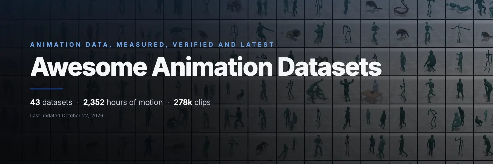

**Every motion dataset worth knowing — measured, reviewed, and one click from playing.**

Motion datasets are many, scattered and hard to compare: different formats, different bodies, no single place to see them. This list is that place: see what every dataset looks like and how clean its motion is, find the right and high-quality one fast, and notice the growing number of new releases. We focus on human motion, but also include animals, objects and robots.


<!-- BEGIN HERO -->
<p><a href="https://huggingface.co/spaces/myshi/motion-viewer"></a></p>
<!-- END HERO -->

| Quick review | Fast retrieval | Verified quality |
|---|---|---|
| Rendered 10 example clips of every dataset in browser — skeletons, SMPL bodies, textured rigged meshes. | One table per category with hours, clips, formats (SMPL / SMPL-X support first) and the links you need. | We keep all data clean: every dataset is checked visually, also measured on [nine red-flag metrics](#quality-red-flags). Broken or unrealistic ones move to **Use with caution**, and not included in the main list. |

<!-- BEGIN STATS -->
**44 datasets · 2,355 hours of motion · 278,246 clips** — human bodies, hands, interactions, animals, rigged objects and robots, 2003–2026. 8 more (5,179 h) are listed under [Use with caution](#use-with-caution).

<p>
<picture><source media="(prefers-color-scheme: dark)" srcset="docs/assets/charts/subject-dark.svg">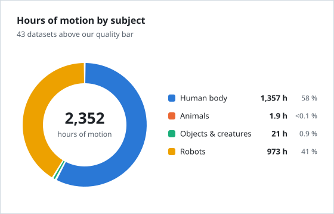</picture>
<picture><source media="(prefers-color-scheme: dark)" srcset="docs/assets/charts/content-dark.svg">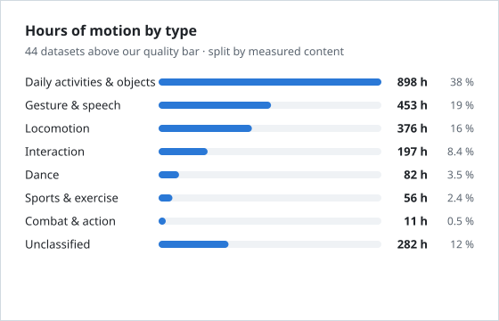</picture>
<br>
<picture><source media="(prefers-color-scheme: dark)" srcset="docs/assets/charts/trend-dark.svg">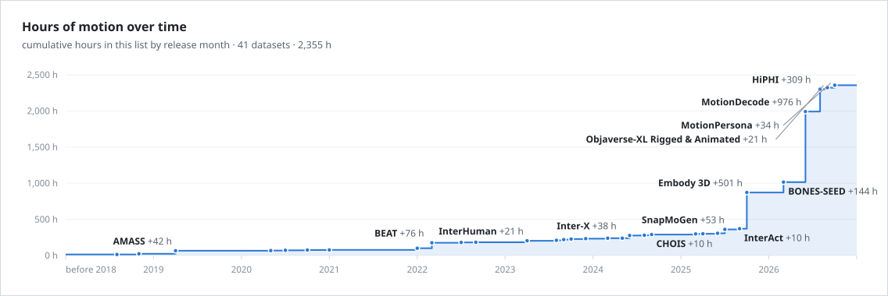</picture>
</p>

<details><summary>The numbers as tables</summary>

| Subject | Datasets | Hours | Share |
|---|--:|--:|--:|
| 🧍 [Human body](docs/categories/human-body.md) | 39 | 1,360 | 58 % |
| 🐾 [Animals](docs/categories/animal.md) | 2 | 1.9 | <0.1 % |
| 🧸 [Objects & creatures](docs/categories/object.md) | 1 | 21.0 | 0.9 % |
| 🤖 [Robots](docs/categories/robot.md) | 2 | 973 | 41 % |
| **Total** | **44** | **2,355** | |

| Motion type | Datasets | Hours | Share |
|---|--:|--:|--:|
| Daily activities & objects | 12 | 898 | 38 % |
| Gesture & speech | 10 | 453 | 19 % |
| Locomotion | 21 | 376 | 16 % |
| Interaction | 7 | 197 | 8.4 % |
| Dance | 7 | 82.3 | 3.5 % |
| Sports & exercise | 2 | 55.6 | 2.4 % |
| Combat & action | 4 | 11.4 | 0.5 % |
| Unclassified | 10 | 282 | 12 % |

</details>

Hours count each recording once: 2 datasets that re-label or re-target another one are listed but not added¹, and 1 datasets publish no duration. Numbers come from each dataset's paper or homepage, or are measured from the data (see [the schema](data/SCHEMA.md)).
<!-- END STATS -->

## About this list

- **What gets in.** High-quality open-source motion datasets with more than an hour of data, with the datasets the community
  commonly uses. Datasets whose motion quality falls short (jitter, foot skating, penetration ...) are still listed,
  under [Use with caution](#use-with-caution).
- **Quick review, not redistribution.** For every dataset we show 10 short example clips online in the
  [Motion Viewer](https://huggingface.co/spaces/myshi/motion-viewer) for a quick look. We do not offer the original motion
  for download: get each dataset from its authors. If you are an author and do not want your examples shown, please
  [open an issue](https://github.com/Shimingyi/awesome-animation-datasets/issues) and we will remove them.
- **Missing a dataset?** A new release, or one we overlooked: [open an issue](https://github.com/Shimingyi/awesome-animation-datasets/issues)
  with its link, or send a pull request (see [Contributing](#contributing)). We hold motion quality to a high bar:
  data reconstructed from video (video mocap) will most likely be listed under Use with caution.
- **Fair durations.** Durations count each recording once: mirrored copies that some releases add are left out
  (BONES-SEED is 144 h here; the 288 h on its page include the mirrored copies). Hours are motion per person: a
  two-person take of one hour counts as 2 h.

<!-- BEGIN NEWS -->
## News

- **Oct 22, 2026** · Added [Seamless Interaction](docs/categories/caution.md#seamless-interaction), under Use with caution: 4,000 h of SMPL-H. Very large two-person conversation corpus with audio, transcripts and SMPL-H estimated from video: dyadic gesture and listener behaviour. · [examples & discussion](https://github.com/Shimingyi/awesome-animation-datasets/issues/1)
<!-- END NEWS -->

## Datasets

Click a dataset for its details (size, capture, format, licence, BibTeX), or ▶ / the previews to play its examples
in the viewer. SMPL, SMPL-H or SMPL-X in the Data column: the dataset ships body-model parameters.

<!-- BEGIN DATASETS -->
### 🧍 Human body

Full-body human motion, one performer or several interacting (mocap, video reconstruction, artist-made). → [details](docs/categories/human-body.md)

| Dataset | Hours | Clips | Data | Links | Viewer | Preview |
|---|--:|--:|---|---|:-:|---|
| [**Embody 3D**](docs/categories/human-body.md#embody-3d)<br><sub>Hundreds of hours of SMPL-X body and hands with per-person audio: conversation, multi-person behaviour and prompted actions.</sub> | 500 | 9.2k | SMPL-X | [home](https://www.meta.com/emerging-tech/codec-avatars/embody-3d/)<br>[code](https://github.com/facebookresearch/embody-3d)<br>[paper](https://arxiv.org/abs/2510.16258) | [▶](https://myshi-motion-viewer.static.hf.space/#embody-3d/day-in-the-life-home-renovations) | <a href="https://myshi-motion-viewer.static.hf.space/#embody-3d/day-in-the-life-home-renovations">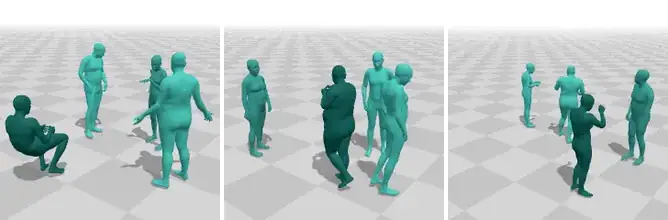</a> |
| [**HiPHI**](docs/categories/human-body.md#hiphi)<br><sub>Hundreds of hours of high-precision whole-body and object-interaction capture: large-scale training.</sub> | 309 | 18k | bvh<br>obj<br>csv | [home](https://noitom-robotics.github.io/hiphi/)<br>[data](https://huggingface.co/datasets/noitomrobotics/HiPHI)<br>[code](https://github.com/noitom-robotics/hiphi)<br>[paper](https://arxiv.org/abs/2608.16222) | [▶](https://myshi-motion-viewer.static.hf.space/#hiphi/adjusting-adjust-0026) | <a href="https://myshi-motion-viewer.static.hf.space/#hiphi/adjusting-adjust-0026">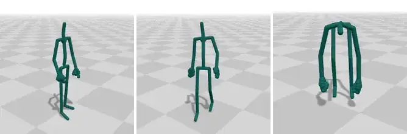</a> |
| [**BONES-SEED**](docs/categories/human-body.md#bones-seed)<br><sub>Huge, varied and clean everyday motion from 500+ performers: pretraining and motion matching.</sub> | 144 | 71k | bvh<br>csv | [home](https://bones.studio/datasets/seed)<br>[data](https://huggingface.co/datasets/bones-studio/seed)<br>[code](https://github.com/bones-studio/seed-viewer) | [▶](https://myshi-motion-viewer.static.hf.space/#bones-seed/egyptian-style-dance) | <a href="https://myshi-motion-viewer.static.hf.space/#bones-seed/egyptian-style-dance">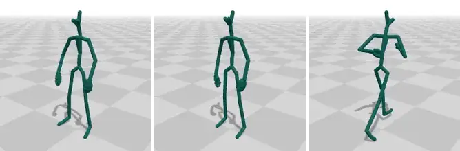</a> |
| [**BEAT**](docs/categories/human-body.md#beat)<br><sub>Co-speech gesture generation from audio and text, with emotion labels.</sub> | 76.0 | – | SMPL-X<br>bvh | [home](https://pantomatrix.github.io/BEAT/)<br>[data](https://huggingface.co/datasets/H-Liu1997/BEAT)<br>[code](https://github.com/PantoMatrix/BEAT)<br>[paper](https://arxiv.org/abs/2203.05297) | [▶](https://myshi-motion-viewer.static.hf.space/#beat/10-kieks-0-103-103) | <a href="https://myshi-motion-viewer.static.hf.space/#beat/10-kieks-0-103-103">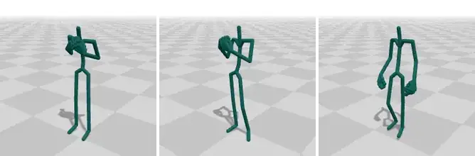</a> |
| [**SnapMoGen**](docs/categories/human-body.md#snapmogen)<br><sub>Text-to-motion with long, expressive descriptions on continuous mocap: fine-grained text control.</sub> | 43.7 | 20k | bvh<br>features | [home](https://snap-research.github.io/SnapMoGen/)<br>[data](https://huggingface.co/datasets/Ericguo5513/SnapMoGen)<br>[code](https://github.com/snap-research/SnapMoGen)<br>[paper](https://arxiv.org/abs/2507.09122) | [▶](https://myshi-motion-viewer.static.hf.space/#snapmogen/dd-00110) | <a href="https://myshi-motion-viewer.static.hf.space/#snapmogen/dd-00110">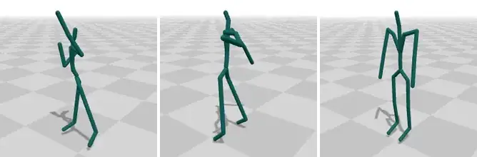</a> |
| [**AMASS**](docs/categories/human-body.md#amass)<br><sub>The standard large SMPL corpus: pretraining body motion priors, text-to-motion, pose estimation.</sub> | 41.5 | 11k | SMPL-H<br>SMPL-X<br>npz | [home](https://amass.is.tue.mpg.de/)<br>[data](https://amass.is.tue.mpg.de/download.php)<br>[code](https://github.com/nghorbani/amass)<br>[paper](https://arxiv.org/abs/1904.03278) | [▶](https://myshi-motion-viewer.static.hf.space/#amass/sfu-cartwheel) | <a href="https://myshi-motion-viewer.static.hf.space/#amass/sfu-cartwheel">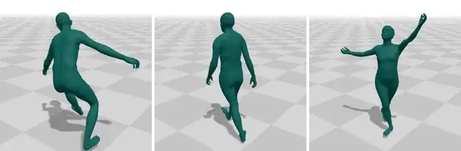</a> |
| [**Inter-X**](docs/categories/human-body.md#inter-x)<br><sub>Two-person interactions with hands and part-level text: text-to-interaction and reaction generation.</sub> | 37.5 | 11k | SMPL-X<br>joints | [home](https://liangxuy.github.io/inter-x/)<br>[code](https://github.com/liangxuy/Inter-X)<br>[paper](https://arxiv.org/abs/2312.16051) | [▶](https://myshi-motion-viewer.static.hf.space/#inter-x/hug-g004t003a000r000) | <a href="https://myshi-motion-viewer.static.hf.space/#inter-x/hug-g004t003a000r000">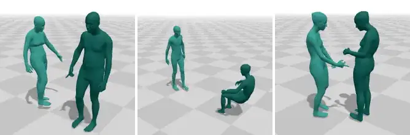</a> |
| [**MotionPersona**](docs/categories/human-body.md#motionpersona)<br><sub>Locomotion across body shapes, ages, emotions and personas: shape- and persona-aware controllers.</sub> | 34.0 | 2.8k | SMPL-X<br>bvh | [home](https://motionpersona25.github.io/)<br>[data](https://huggingface.co/datasets/myshi/MotionPersona)<br>[code](https://github.com/AIGAnimation/MotionPersona)<br>[paper](https://arxiv.org/abs/2506.00173) | [▶](https://myshi-motion-viewer.static.hf.space/#motionpersona/p40-neutral-walk-forward) | <a href="https://myshi-motion-viewer.static.hf.space/#motionpersona/p40-neutral-walk-forward">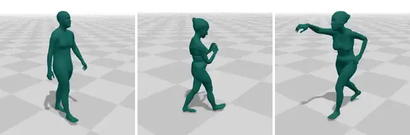</a> |
| [**100STYLE**](docs/categories/human-body.md#100style)<br><sub>Style-conditioned locomotion and style transfer: 100 walking / running styles from one actor.</sub> | 22.1 | 810 | bvh | [home](https://www.ianxmason.com/100style/)<br>[data](https://zenodo.org/record/8127870)<br>[paper](https://arxiv.org/abs/2201.04439) | [▶](https://myshi-motion-viewer.static.hf.space/#100style/aeroplane-tr1) | <a href="https://myshi-motion-viewer.static.hf.space/#100style/aeroplane-tr1">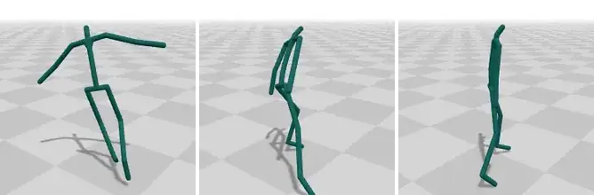</a> |
| [**InterHuman**](docs/categories/human-body.md#interhuman)<br><sub>Text-to-two-person interaction: daily interactions plus fighting, dance and sports duets.</sub> | 20.9 | 7.8k | SMPL<br>joints | [home](https://tr3e.github.io/intergen-page/)<br>[data](https://drive.google.com/drive/folders/1oyozJ4E7Sqgsr7Q747Na35tWo5CjNYk3?usp=sharing)<br>[code](https://github.com/tr3e/InterGen)<br>[paper](https://arxiv.org/abs/2304.05684) | [▶](https://myshi-motion-viewer.static.hf.space/#interhuman/meet-and-shake-hands) | <a href="https://myshi-motion-viewer.static.hf.space/#interhuman/meet-and-shake-hands">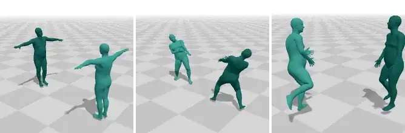</a> |
| [**InterACT++**](docs/categories/human-body.md#interact-plus-plus)<br><sub>Two-person interaction as SMPL-X bodies: interaction generation with body models.</sub> | 13.5¹ | 811 | SMPL-X<br>npz | [home](https://huggingface.co/datasets/dafeiqin/SMPL-Interact-Plus)<br>[data](https://huggingface.co/datasets/dafeiqin/SMPL-Interact-Plus)<br>[paper](https://arxiv.org/abs/2412.02419) | [▶](https://myshi-motion-viewer.static.hf.space/#interact-plus-plus/take-20231119-051) | <a href="https://myshi-motion-viewer.static.hf.space/#interact-plus-plus/take-20231119-051">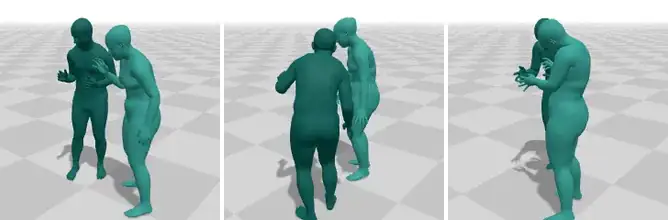</a> |
| [**CHOIS**](docs/categories/human-body.md#chois)<br><sub>Text- and waypoint-conditioned human-object interaction (carrying, pushing, pulling furniture and boxes) on SMPL-X.</sub> | 10.0 | – | SMPL-X | [home](https://lijiaman.github.io/projects/chois/)<br>[data](https://drive.google.com/file/d/1ZG-9--RfUWj5oWYnvcONNuRuxaH_Zpw1/view?usp=sharing)<br>[code](https://github.com/lijiaman/chois_release)<br>[paper](https://arxiv.org/abs/2312.03913) | [▶](https://myshi-motion-viewer.static.hf.space/#chois/sub16-clothesstand-000) | <a href="https://myshi-motion-viewer.static.hf.space/#chois/sub16-clothesstand-000">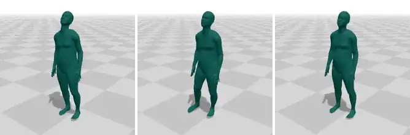</a> |
| [**InterAct**](docs/categories/human-body.md#interact)<br><sub>Two-person conversation and interaction with audio and face: multi-character generation.</sub> | 10.0 | 241 | bvh<br>blendshapes<br>wav | [home](https://hku-cg.github.io/interact/)<br>[data](https://huggingface.co/datasets/leohocs/interact)<br>[paper](https://arxiv.org/abs/2509.05747) | [▶](https://myshi-motion-viewer.static.hf.space/#interact/take-051) | <a href="https://myshi-motion-viewer.static.hf.space/#interact/take-051">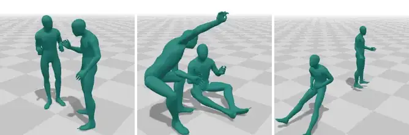</a> |
| [**OMOMO**](docs/categories/human-body.md#omomo)<br><sub>Full-body motion while manipulating 15 everyday objects: object-conditioned human motion.</sub> | 10.0 | – | SMPL-X | [home](https://lijiaman.github.io/projects/omomo/)<br>[data](https://drive.google.com/file/d/1tZVqLB7II0whI-Qjz-z-AU3ponSEyAmm/view?usp=sharing)<br>[code](https://github.com/lijiaman/omomo_release)<br>[paper](https://arxiv.org/abs/2309.16237) | [▶](https://myshi-motion-viewer.static.hf.space/#omomo/wood-chair-lift-overhead-and-walk) | <a href="https://myshi-motion-viewer.static.hf.space/#omomo/wood-chair-lift-overhead-and-walk">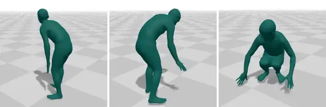</a> |
| [**Trinity Speech-Gesture**](docs/categories/human-body.md#trinity-speech-gesture)<br><sub>Long spontaneous conversational monologues with speech: co-speech gesture generation and the GENEA 2020 benchmark.</sub> | 10.0 | 48 | bvh<br>fbx<br>wav | [home](https://trinityspeechgesture.scss.tcd.ie/)<br>[data](https://trinityspeechgesture.scss.tcd.ie/data/)<br>[paper](https://dl.acm.org/doi/10.1145/3267851.3267898) | [▶](https://myshi-motion-viewer.static.hf.space/#trinity-speech-gesture/part-i-take-01) | <a href="https://myshi-motion-viewer.static.hf.space/#trinity-speech-gesture/part-i-take-01">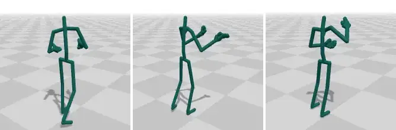</a> |
| [**SAM**](docs/categories/human-body.md#sam)<br><sub>Reacting to where a sound comes from: spatial-audio-driven motion generation with binaural audio and source locations.</sub> | 9.5 | – | bvh<br>c3d<br>npz<br>wav | [home](https://people.csail.mit.edu/frankzydou/projects/MOSPA/index.html)<br>[data](https://huggingface.co/datasets/JimSYXu/SAM)<br>[code](https://github.com/xsy27/Mospa-Acoustic-driven-Motion-Generation)<br>[paper](https://arxiv.org/abs/2507.11949) | [▶](https://myshi-motion-viewer.static.hf.space/#sam/0000000-sound-front-insensitive) | <a href="https://myshi-motion-viewer.static.hf.space/#sam/0000000-sound-front-insensitive">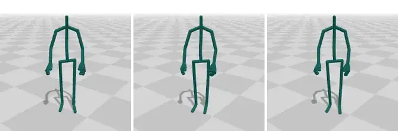</a> |
| [**CMU Mocap**](docs/categories/human-body.md#cmu)<br><sub>Classic broad mocap library: quick prototyping, retargeting tests, baselines.</sub> | 9.1 | 2.6k | asf-amc<br>c3d | [home](http://mocap.cs.cmu.edu)<br>[data](http://mocap.cs.cmu.edu/faqs.php) | [▶](https://myshi-motion-viewer.static.hf.space/#cmu/01-04) | <a href="https://myshi-motion-viewer.static.hf.space/#cmu/01-04">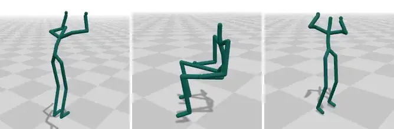</a> |
| [**PerMo**](docs/categories/human-body.md#permo)<br><sub>The same ten actions in 34 styles by five actors: persona- and style-personalized motion generation.</sub> | 8.5 | 6.6k | SMPL-H<br>bvh<br>c3d | [home](https://github.com/AIRC-KETI-VISION/PerMo-dataset)<br>[data](https://github.com/AIRC-KETI-VISION/PerMo-dataset#overview)<br>[code](https://github.com/AIRC-KETI-VISION/PerMo-dataset)<br>[paper](https://arxiv.org/abs/2503.07390) | [▶](https://myshi-motion-viewer.static.hf.space/#permo/zombie-walk-actor-1) | <a href="https://myshi-motion-viewer.static.hf.space/#permo/zombie-walk-actor-1">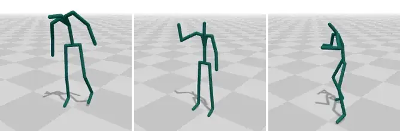</a> |
| [**FineDance**](docs/categories/human-body.md#finedance)<br><sub>Music-to-dance with finger motion across 22 fine-grained genres.</sub> | 7.7 | – | SMPL-H | [home](https://li-ronghui.github.io/finedance)<br>[data](https://drive.google.com/file/d/1zQvWG9I0H4U3Zrm8d_QD_ehenZvqfQfS/view?usp=sharing)<br>[code](https://github.com/li-ronghui/FineDance)<br>[paper](https://arxiv.org/abs/2212.03741) | [▶](https://myshi-motion-viewer.static.hf.space/#finedance/breaking-song-052) | <a href="https://myshi-motion-viewer.static.hf.space/#finedance/breaking-song-052">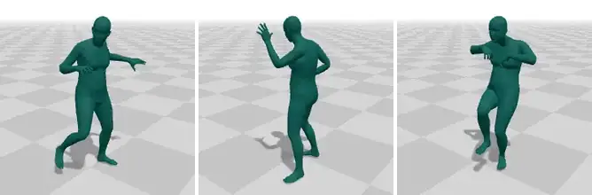</a> |
| [**CHOICE**](docs/categories/human-body.md#choice)<br><sub>Long bimanual pick-and-place, cooking and drawer/door interactions in cluttered rooms, with fingers: scene-interaction controllers.</sub> | 6.8 | 131 | bvh | [home](https://lujintaozju.github.io/publications/CHOICE/)<br>[data](https://connecthkuhk-my.sharepoint.com/:f:/g/personal/u3008430_connect_hku_hk/IgCVytmit6wVSqImN5oBra6BAZ2C-u1cfbieAHH_P-Ddc9o?e=Q6ruZn)<br>[paper](https://arxiv.org/abs/2412.06702) | [▶](https://myshi-motion-viewer.static.hf.space/#choice/kitchen-0326-24round-kitchen-0) | <a href="https://myshi-motion-viewer.static.hf.space/#choice/kitchen-0326-24round-kitchen-0">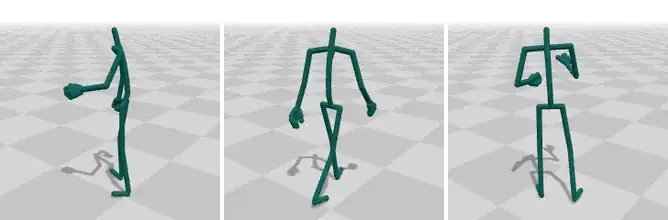</a> |
| [**DD100**](docs/categories/human-body.md#dd100)<br><sub>Partner dance duets with finger motion and music: leader-follower dance accompaniment.</sub> | 6.5 | 167 | SMPL-X | [home](https://lisiyao21.github.io/projects/Duolando)<br>[data](https://drive.google.com/file/d/1sWc1MeRhRa9LoxarsJVFvt5vxsRk-F_M/view?usp=sharing)<br>[code](https://github.com/lisiyao21/Duolando)<br>[paper](https://arxiv.org/abs/2403.18811) | [▶](https://myshi-motion-viewer.static.hf.space/#dd100/ballet-choreography-001) | <a href="https://myshi-motion-viewer.static.hf.space/#dd100/ballet-choreography-001">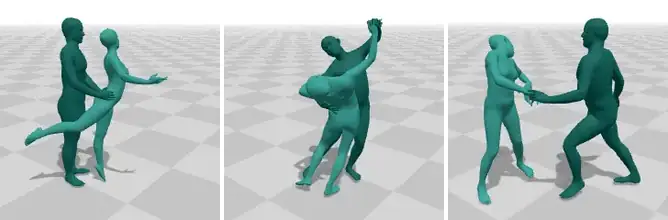</a> |
| [**Motorica Dance**](docs/categories/human-body.md#motorica-dance)<br><sub>Music-driven dance in eight styles: music-to-dance generation.</sub> | 6.0 | 121 | bvh | [home](https://github.com/simonalexanderson/MotoricaDanceDataset)<br>[data](https://kth-my.sharepoint.com/:f:/g/personal/simonal_ug_kth_se/IgC-FlBB7gLRR5KIF4Jmsp6dAb3zrmQYayK8Xh2wVyUcoGk?e=VYwCCW)<br>[code](https://github.com/simonalexanderson/ListenDenoiseAction)<br>[paper](https://arxiv.org/abs/2211.09707) | [▶](https://myshi-motion-viewer.static.hf.space/#motorica-dance/hip-hop) | <a href="https://myshi-motion-viewer.static.hf.space/#motorica-dance/hip-hop">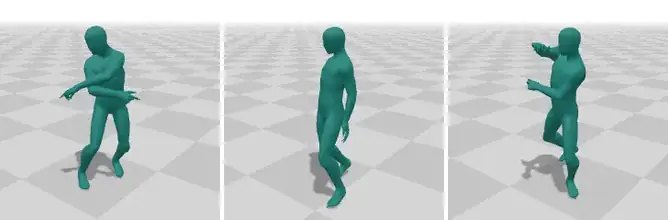</a> |
| [**LAFAN1**](docs/categories/human-body.md#lafan1)<br><sub>Long unedited takes with locomotion, fights and falls: in-betweening and motion matching.</sub> | 4.6 | 77 | bvh | [home](https://github.com/ubisoft/ubisoft-laforge-animation-dataset)<br>[paper](https://arxiv.org/abs/2102.04942) | [▶](https://myshi-motion-viewer.static.hf.space/#lafan1/fight) | <a href="https://myshi-motion-viewer.static.hf.space/#lafan1/fight">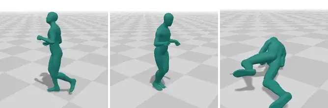</a> |
| [**MOCCA Gesture**](docs/categories/human-body.md#mocca-gesture)<br><sub>Chinese monologue co-speech gesture with audio and transcripts: gesture generation beyond English.</sub> | 4.5 | 30 | bvh<br>wav<br>srt | [home](https://github.com/Aubrey-ao/HumanBehaviorAnimation/tree/main/HumanBehaviorAnimation/RhythmicGesticulator/MOCCA_Gesture_Dataset)<br>[data](https://drive.google.com/file/d/1zxbzGWSzw53d3GMVxUW-REFTdLq_jrMu/view?usp=sharing)<br>[code](https://github.com/Aubrey-ao/HumanBehaviorAnimation)<br>[paper](https://arxiv.org/abs/2210.01448) | [▶](https://myshi-motion-viewer.static.hf.space/#mocca-gesture/speaker-1-clip-1) | <a href="https://myshi-motion-viewer.static.hf.space/#mocca-gesture/speaker-1-clip-1">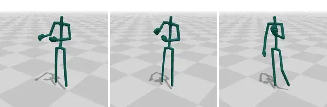</a> |
| [**Bandai Namco Motion**](docs/categories/human-body.md#bandai-namco)<br><sub>Everyday actions in many styles and emotions, on a clean game rig: style transfer.</sub> | 3.9 | 3.1k | bvh | [home](https://github.com/BandaiNamcoResearchInc/Bandai-Namco-Research-Motiondataset)<br>[paper](https://arxiv.org/abs/2306.08861) | [▶](https://myshi-motion-viewer.static.hf.space/#bandai-namco/dataset-1-bow-musical-001) | <a href="https://myshi-motion-viewer.static.hf.space/#bandai-namco/dataset-1-bow-musical-001">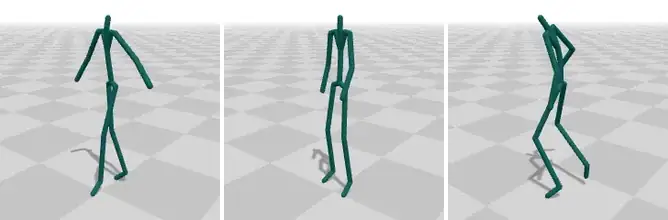</a> |
| [**Adult2Child**](docs/categories/human-body.md#adult2child)<br><sub>Child vs adult motion: age-style transfer and child character animation.</sub> | 3.1 | 973 | bvh<br>fbx<br>csv | [home](https://andreasaristidou.com/Adult2Child)<br>[data](https://zenodo.org/records/4079507)<br>[code](https://gitlab.com/jainlab/cyclegan-1-master)<br>[paper](https://doi.org/10.1145/3424636.3426909) | [▶](https://myshi-motion-viewer.static.hf.space/#adult2child/pose-child001-broad-jump-fwd-two-feet-001) | <a href="https://myshi-motion-viewer.static.hf.space/#adult2child/pose-child001-broad-jump-fwd-two-feet-001">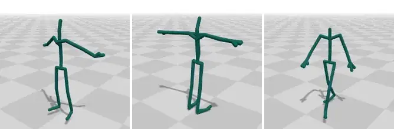</a> |
| [**MAMMA**](docs/categories/human-body.md#mamma)<br><sub>Markerless multi-view SMPL-X capture of partner dance and close multi-person interaction, with the videos.</sub> | 3.1 | 251 | SMPL-X<br>npz<br>video | [home](https://mamma.is.tue.mpg.de/)<br>[data](https://mamma.is.tue.mpg.de/download.php)<br>[code](https://github.com/cuevhv/mamma)<br>[paper](https://arxiv.org/abs/2506.13040) | [▶](https://myshi-motion-viewer.static.hf.space/#mamma/west-coast-swing-telemark) | <a href="https://myshi-motion-viewer.static.hf.space/#mamma/west-coast-swing-telemark">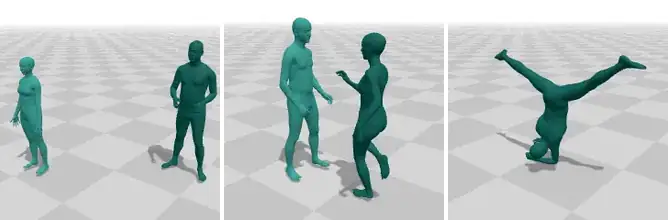</a> |
| [**Cranberry**](docs/categories/human-body.md#cranberry)<br><sub>Unstructured VR-style locomotion and upper-body activity: three-point tracking and embodied avatar controllers.</sub> | 3.0 | 91 | fbx<br>glb | [home](https://github.com/sebastianstarke/AI4Animation)<br>[data](https://starke-consult.de/AI4Animation/SIGGRAPH_2024/Cranberry_Dataset.zip)<br>[code](https://github.com/sebastianstarke/AI4Animation/tree/master/AI4Animation/SIGGRAPH_2024)<br>[paper](https://github.com/sebastianstarke/AI4Animation/blob/master/Media/SIGGRAPH_2024/Paper.pdf) | [▶](https://myshi-motion-viewer.static.hf.space/#cranberry/sh02-cranberry-s01-crouching-and-loco-002) | <a href="https://myshi-motion-viewer.static.hf.space/#cranberry/sh02-cranberry-s01-crouching-and-loco-002">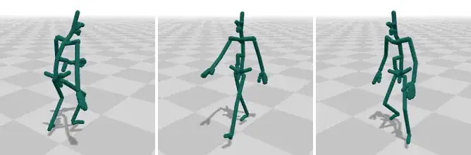</a> |
| [**Human3.6M**](docs/categories/human-body.md#human36m)<br><sub>The classic benchmark for 3D human pose estimation from video, and short-term motion prediction.</sub> | 2.9 | 210 | cdf<br>video | [home](http://vision.imar.ro/human3.6m/description.php)<br>[paper](https://ieeexplore.ieee.org/document/6682899) | [▶](https://myshi-motion-viewer.static.hf.space/#human36m/walking-s9) | <a href="https://myshi-motion-viewer.static.hf.space/#human36m/walking-s9">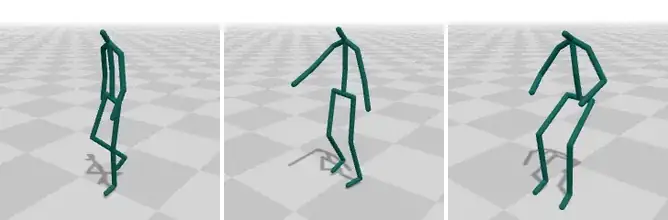</a> |
| [**Multi-Subject Motion**](docs/categories/human-body.md#multi-subject)<br><sub>The same locomotion patterns from twelve performers: subject / style-conditioned models.</sub> | 2.2 | 269 | bvh | [home](https://arxiv.org/abs/2101.12276)<br>[paper](https://doi.org/10.1007/s41095-022-0307-3) | [▶](https://myshi-motion-viewer.static.hf.space/#multi-subject/jb-jl-res-subject11-facez) | <a href="https://myshi-motion-viewer.static.hf.space/#multi-subject/jb-jl-res-subject11-facez">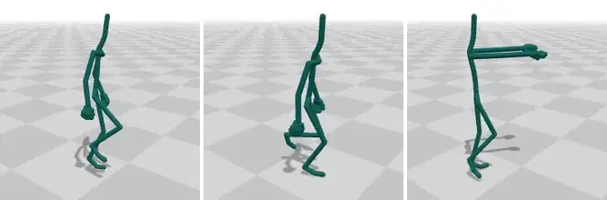</a> |
| [**BFA**](docs/categories/human-body.md#bfa)<br><sub>Small style-transfer benchmark: the same motions in 16 styles.</sub> | 2.2 | 64 | bvh | [home](https://deepmotionediting.github.io/style_transfer)<br>[data](https://drive.google.com/drive/folders/1C-_iZJj-PSUWZwh25yAsQe1tLpPm9EZ5)<br>[code](https://github.com/DeepMotionEditing/deep-motion-editing)<br>[paper](https://arxiv.org/abs/2005.05751) | [▶](https://myshi-motion-viewer.static.hf.space/#bfa/angry-01) | <a href="https://myshi-motion-viewer.static.hf.space/#bfa/angry-01">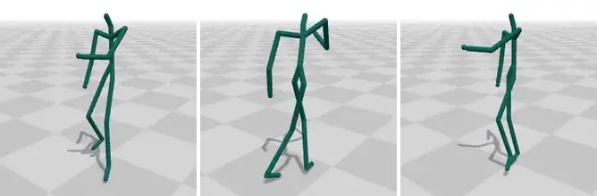</a> |
| [**ZeroEGGS**](docs/categories/human-body.md#zeroeggs)<br><sub>Zero-shot style-controllable co-speech gesture generation.</sub> | 2.2 | 67 | bvh | [home](https://github.com/ubisoft/ubisoft-laforge-ZeroEGGS)<br>[code](https://github.com/ubisoft/ubisoft-laforge-ZeroEGGS)<br>[paper](https://arxiv.org/abs/2209.07556) | [▶](https://myshi-motion-viewer.static.hf.space/#zeroeggs/happy) | <a href="https://myshi-motion-viewer.static.hf.space/#zeroeggs/happy">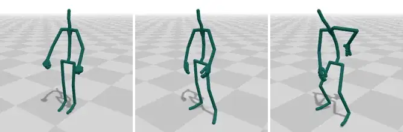</a> |
| [**HUMOTO**](docs/categories/human-body.md#humoto)<br><sub>Artist-cleaned full-body and finger interaction with 63 modelled objects on a Mixamo rig: human-object interaction.</sub> | 2.2 | 735 | fbx<br>glb | [home](https://jiaxin-lu.github.io/humoto/)<br>[data](https://adobe-research.github.io/humoto/)<br>[code](https://github.com/Jiaxin-Lu/humoto)<br>[paper](https://arxiv.org/abs/2504.10414) | [▶](https://myshi-motion-viewer.static.hf.space/#humoto/baking-with-a-spatula) | <a href="https://myshi-motion-viewer.static.hf.space/#humoto/baking-with-a-spatula">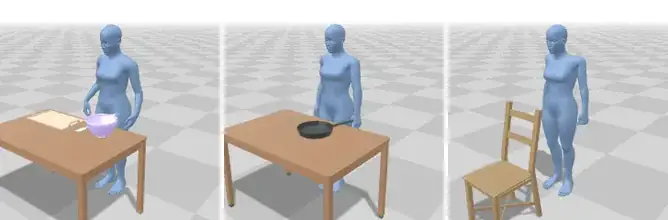</a> |
| [**PFNN**](docs/categories/human-body.md#pfnn)<br><sub>Terrain-aware locomotion (flat, stairs, obstacles): character controllers like PFNN.</sub> | 1.0 | 40 | bvh | [home](https://theorangeduck.com/page/phase-functioned-neural-networks-character-control)<br>[data](https://theorangeduck.com/media/uploads/other_stuff/pfnn.zip)<br>[paper](https://theorangeduck.com/media/uploads/other_stuff/phasefunction.pdf) | [▶](https://myshi-motion-viewer.static.hf.space/#pfnn/locomotionflat01-000) | <a href="https://myshi-motion-viewer.static.hf.space/#pfnn/locomotionflat01-000">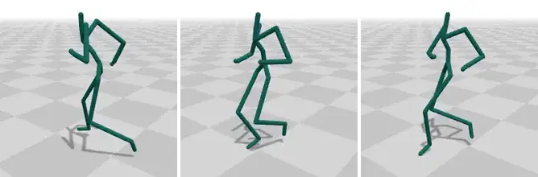</a> |
| [**Environment-aware Motion Matching**](docs/categories/human-body.md#environment-motion-matching)<br><sub>A compact motion-matching database for walking around obstacles and through crowds: drop-in Unity controllers.</sub> | 0.85 | 60 | bvh | [home](https://upc-virvig.github.io/Environment-aware-Motion-Matching/)<br>[data](https://zenodo.org/records/17220516)<br>[code](https://github.com/UPC-ViRVIG/Environment-aware-Motion-Matching)<br>[paper](https://arxiv.org/abs/2510.22632) | [▶](https://myshi-motion-viewer.static.hf.space/#environment-motion-matching/a1-1) | <a href="https://myshi-motion-viewer.static.hf.space/#environment-motion-matching/a1-1">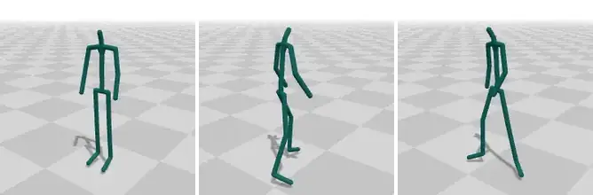</a> |
| [**SeG (Semantic Gesticulator)**](docs/categories/human-body.md#semantic-gesticulator)<br><sub>A library of 208 labelled semantic gestures with fingers: semantic gesture retrieval and insertion.</sub> | 0.60 | 544 | bvh | [home](https://pku-mocca.github.io/Semantic-Gesticulator-Page/)<br>[data](https://github.com/LuMen-ze/Semantic-Gesticulator-Official/tree/main/SeG_dataset)<br>[code](https://github.com/LuMen-ze/Semantic-Gesticulator-Official)<br>[paper](https://arxiv.org/abs/2405.09814) | [▶](https://myshi-motion-viewer.static.hf.space/#semantic-gesticulator/arm-flex-strength) | <a href="https://myshi-motion-viewer.static.hf.space/#semantic-gesticulator/arm-flex-strength">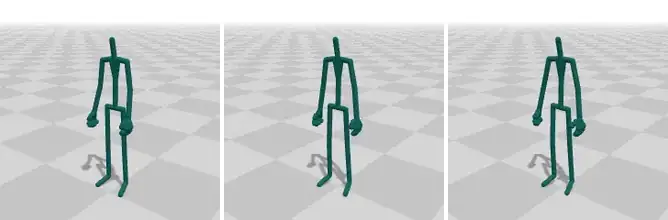</a> |
| [**Edinburgh Locomotion**](docs/categories/human-body.md#edinburgh-locomotion)<br><sub>Short locomotion set from the deep motion synthesis work: small character-control experiments.</sub> | 0.30 | 47 | bvh | [home](https://theorangeduck.com/page/deep-learning-framework-character-motion-synthesis-and-editing)<br>[data](https://theorangeduck.com/media/uploads/other_stuff/motionsynth_data.zip)<br>[paper](https://theorangeduck.com/page/deep-learning-framework-character-motion-synthesis-and-editing) | [▶](https://myshi-motion-viewer.static.hf.space/#edinburgh-locomotion/locomotion-jog-sidestep-000-005) | <a href="https://myshi-motion-viewer.static.hf.space/#edinburgh-locomotion/locomotion-jog-sidestep-000-005">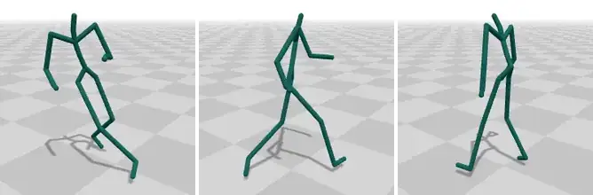</a> |
| [**Xia**](docs/categories/human-body.md#xia)<br><sub>Classic stylized locomotion benchmark: real-time style transfer.</sub> | 0.20 | 572 | bvh | [home](https://web.archive.org/web/20210621091519/http://humanmotion.ict.ac.cn/papers/2015P1_StyleTransfer/details.htm)<br>[paper](https://doi.org/10.1145/2766999) | [▶](https://myshi-motion-viewer.static.hf.space/#xia/angry-05-000) | <a href="https://myshi-motion-viewer.static.hf.space/#xia/angry-05-000">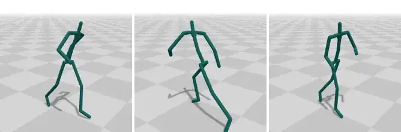</a> |
| [**Mixamo**](docs/categories/human-body.md#mixamo)<br><sub>Ready-made game animations on many characters: prototyping and retargeting.</sub> | – | – | fbx<br>dae | [home](https://www.mixamo.com) | [▶](https://myshi-motion-viewer.static.hf.space/#mixamo/armada-to-esquiva) | <a href="https://myshi-motion-viewer.static.hf.space/#mixamo/armada-to-esquiva">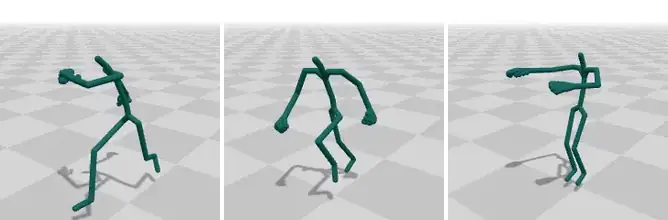</a> |

### 🐾 Animals

Quadrupeds, birds, insects, fish and other creatures, captured or keyframed. → [details](docs/categories/animal.md)

| Dataset | Hours | Clips | Data | Links | Viewer | Preview |
|---|--:|--:|---|---|:-:|---|
| [**Truebones Zoo**](docs/categories/animal.md#truebones-zoo)<br><sub>Dozens of animal species with rigs and meshes: any-skeleton and animal motion research.</sub> | 1.4 | 1.2k | fbx<br>bvh | [home](https://truebones.gumroad.com/l/skZMC) | [▶](https://myshi-motion-viewer.static.hf.space/#truebones-zoo/elephant-walk) | <a href="https://myshi-motion-viewer.static.hf.space/#truebones-zoo/elephant-walk">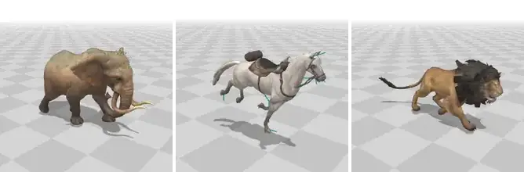</a> |
| [**MANN Dog**](docs/categories/animal.md#mann-dog)<br><sub>Quadruped (dog) gaits and transitions: quadruped character control.</sub> | 0.50 | 51 | bvh | [home](https://github.com/sebastianstarke/AI4Animation)<br>[data](https://starke-consult.de/AI4Animation/SIGGRAPH_2018/MotionCapture.zip)<br>[code](https://github.com/sebastianstarke/AI4Animation/tree/master/AI4Animation/SIGGRAPH_2018)<br>[paper](https://github.com/sebastianstarke/AI4Animation/blob/master/Media/SIGGRAPH_2018/Paper.pdf) | [▶](https://myshi-motion-viewer.static.hf.space/#mann-dog/d1-010-kan01-004) | <a href="https://myshi-motion-viewer.static.hf.space/#mann-dog/d1-010-kan01-004">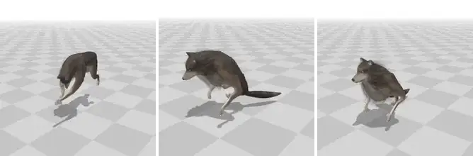</a> |

### 🧸 Objects & creatures

Rigged and animated 3D assets of any kind (props, toys, plants, fantasy creatures, vehicles). → [details](docs/categories/object.md)

| Dataset | Hours | Clips | Data | Links | Viewer | Preview |
|---|--:|--:|---|---|:-:|---|
| [**Objaverse-XL Rigged & Animated**](docs/categories/object.md#objaverse-xl-rigged-animated)<br><sub>Thousands of rigged, animated 3D assets of any shape: rigging and any-skeleton motion.</sub> | 21.0 | 16k | glb | [home](https://huggingface.co/datasets/Linzhan/Objaverse-XL-Rigged-Animated)<br>[code](https://github.com/Friedrich-M/UniMate/tree/main/data_process)<br>[paper](https://arxiv.org/abs/2609.05415) | [▶](https://myshi-motion-viewer.static.hf.space/#objaverse-xl-rigged-animated/hummingbird-hover) | <a href="https://myshi-motion-viewer.static.hf.space/#objaverse-xl-rigged-animated/hummingbird-hover">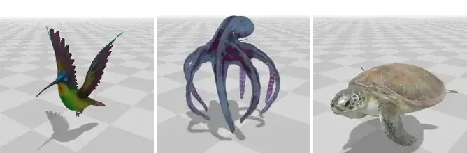</a> |

### 🤖 Robots

Motion on robot kinematics (humanoids, quadrupeds), usually retargeted from human or animal data. → [details](docs/categories/robot.md)

| Dataset | Hours | Clips | Data | Links | Viewer | Preview |
|---|--:|--:|---|---|:-:|---|
| [**MotionDecode**](docs/categories/robot.md#motiondecode)<br><sub>Nearly 1,000 h of optical mocap retargeted to the Unitree G1, in 480 labelled everyday, work, social and sports tasks: humanoid imitation learning.</sub> | 973 | 91k | csv | [home](https://chingmudata.github.io/MotionDecode/)<br>[data](https://huggingface.co/datasets/CMRobot/MotionDecode) | [▶](https://myshi-motion-viewer.static.hf.space/#motiondecode/g1-basic-gait-normal-walking) | <a href="https://myshi-motion-viewer.static.hf.space/#motiondecode/g1-basic-gait-normal-walking">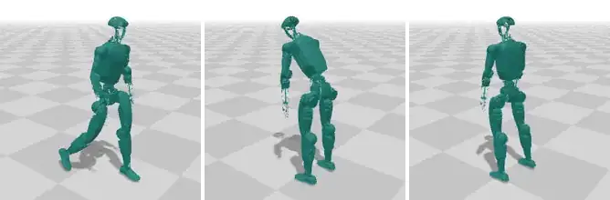</a> |
| [**Unitree LAFAN1 Retargeting**](docs/categories/robot.md#unitree-lafan1-retarget)<br><sub>Human motion retargeted to Unitree humanoids: robot imitation learning.</sub> | 2.5¹ | 40 | csv | [home](https://huggingface.co/datasets/unitreerobotics/LAFAN1_Retargeting_Dataset) | [▶](https://myshi-motion-viewer.static.hf.space/#unitree-lafan1-retarget/g1-dance1-s2) | <a href="https://myshi-motion-viewer.static.hf.space/#unitree-lafan1-retarget/g1-dance1-s2">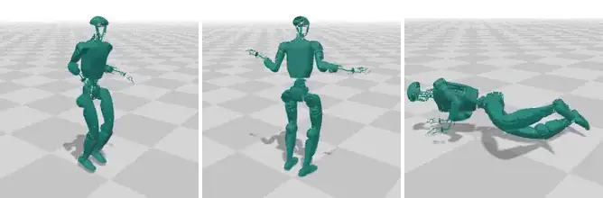</a> |

### Use with caution

Datasets whose motion quality fell short when we inspected it (jitter, foot skating, penetration ...). They are still large and useful for some purposes; read the reason before you use them. → [details](docs/categories/caution.md)

| Dataset | Hours | Clips | Data | Links | Viewer | Preview |
|---|--:|--:|---|---|:-:|---|
| [**Seamless Interaction**](docs/categories/caution.md#seamless-interaction)<br><sub>Very large two-person conversation corpus with audio, transcripts and SMPL-H estimated from video: dyadic gesture and listener behaviour.</sub> | 4,000 | – | SMPL-H | [home](https://huggingface.co/datasets/facebook/seamless-interaction)<br>[code](https://github.com/facebookresearch/seamless_interaction)<br>[paper](https://arxiv.org/abs/2506.22554) | [▶](https://myshi-motion-viewer.static.hf.space/#seamless-interaction/improvised-conversation-p0799) | <a href="https://myshi-motion-viewer.static.hf.space/#seamless-interaction/improvised-conversation-p0799">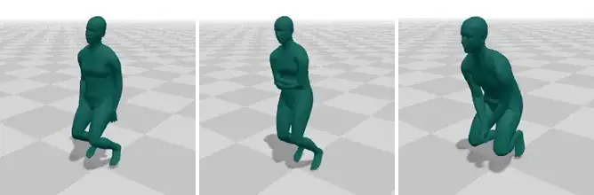</a> |
| [**MotionMillion**](docs/categories/caution.md#motionmillion)<br><sub>Very large text-annotated motion corpus for zero-shot text-to-motion; quality varies (video mocap).</sub> | 988 | 685k | features | [home](https://huggingface.co/datasets/InternRobotics/MotionMillion)<br>[data](https://huggingface.co/datasets/InternRobotics/MotionMillion) | [▶](https://myshi-motion-viewer.static.hf.space/#motionmillion/motiongv-folder1-061406) | <a href="https://myshi-motion-viewer.static.hf.space/#motionmillion/motiongv-folder1-061406">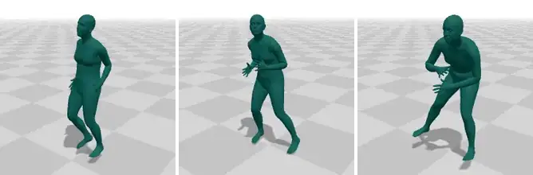</a> |
| [**Motion-X**](docs/categories/caution.md#motion-x)<br><sub>Very large whole-body SMPL-X with text, mostly from video: coverage over quality.</sub> | 144 | 81k | SMPL-X | [home](https://motion-x-dataset.github.io)<br>[code](https://github.com/IDEA-Research/Motion-X)<br>[paper](https://arxiv.org/abs/2307.00818) | [▶](https://myshi-motion-viewer.static.hf.space/#motion-x/badminton-underswing-clip-1) | <a href="https://myshi-motion-viewer.static.hf.space/#motion-x/badminton-underswing-clip-1"></a> |
| [**AnimationGPT**](docs/categories/caution.md#animationgpt)<br><sub>Game-style combat moves with text: text-to-motion for fighting and action games.</sub> | 26.4 | 15k | joints<br>features | [home](https://github.com/fyyakaxyy/AnimationGPT)<br>[data](https://drive.google.com/file/d/148AwoovJrnh4F0q_HbU83WCWwFooLSZj/view?usp=drive_link)<br>[code](https://github.com/fyyakaxyy/AnimationGPT) | [▶](https://myshi-motion-viewer.static.hf.space/#animationgpt/cmp000081) | <a href="https://myshi-motion-viewer.static.hf.space/#animationgpt/cmp000081"></a> |
| [**KIT-ML**](docs/categories/caution.md#kit-ml)<br><sub>Text-to-motion benchmark with natural-language descriptions.</sub> | 11.2 | 3.9k | c3d<br>mmm | [home](https://motion-annotation.humanoids.kit.edu/dataset/)<br>[data](https://motion-annotation.humanoids.kit.edu/downloads/4/)<br>[paper](https://arxiv.org/abs/1607.03827) | [▶](https://myshi-motion-viewer.static.hf.space/#kit-ml/00014) | <a href="https://myshi-motion-viewer.static.hf.space/#kit-ml/00014"></a> |
| [**AIST++**](docs/categories/caution.md#aistpp)<br><sub>Street-dance motion paired with music in 10 genres: the standard benchmark for music-to-dance generation.</sub> | 5.2 | 1.4k | SMPL<br>keypoints<br>pkl | [home](https://google.github.io/aistplusplus_dataset/)<br>[data](https://github.com/google/aistplusplus_dataset/releases/tag/v1.0)<br>[code](https://github.com/google/aistplusplus_api)<br>[paper](https://arxiv.org/abs/2101.08779) | [▶](https://myshi-motion-viewer.static.hf.space/#aistpp/breaking-choreography) | <a href="https://myshi-motion-viewer.static.hf.space/#aistpp/breaking-choreography"></a> |
| [**BOTH57M**](docs/categories/caution.md#both57m)<br><sub>Two-hand motion with finger-level text, on a moving body: hand generation from text and body dynamics.</sub> | 4.2 | 3.2k | SMPL-H | [home](https://godheritage.github.io/BOTH2Hands/)<br>[code](https://github.com/Godheritage/BOTH2Hands)<br>[paper](https://arxiv.org/abs/2312.07937) | [▶](https://myshi-motion-viewer.static.hf.space/#both57m/clapping-for-attention) | <a href="https://myshi-motion-viewer.static.hf.space/#both57m/clapping-for-attention"></a> |
| [**PHUMA**](docs/categories/caution.md#phuma)<br><sub>Large physics-filtered human motion retargeted to Unitree G1 and H1-2: humanoid imitation learning.</sub> | 73.0¹ | 76k | npy | [home](https://davian-robotics.github.io/PHUMA/)<br>[data](https://huggingface.co/datasets/DAVIAN-Robotics/PHUMA)<br>[code](https://github.com/DAVIAN-Robotics/PHUMA)<br>[paper](https://arxiv.org/abs/2510.26236) | [▶](https://myshi-motion-viewer.static.hf.space/#phuma/g1-amass-humanml3d-014612) | <a href="https://myshi-motion-viewer.static.hf.space/#phuma/g1-amass-humanml3d-014612"></a> |

- **Seamless Interaction**: Root drift / floating, unnatural body angles. Estimated from single-camera video: the root position is depth noise (several cm per frame, metres of drift per clip), the legs are mostly out of view and come out bent or crouched, and the poses look stiff. The viewer shows the released rotations with the root held in place.
- **MotionMillion**: Foot skating, unnatural body angles. Reconstructed from web video (video mocap): foot skating and motion that does not look physically real in the examples we inspected.
- **Motion-X**: Jitter / high-frequency noise, foot skating, ground or self penetration. Most of the motion is reconstructed from monocular video: strong jitter, foot skating and ground / self penetration across the examples we inspected.
- **AnimationGPT**: Jitter / high-frequency noise, unnatural body angles. Jittery motion that does not look real in the examples we inspected.
- **KIT-ML**: Low frame rate, jitter / high-frequency noise, foot skating. Low frame rate: the release most work uses (processed like HumanML3D) is 12.5 fps. The motion jitters and the feet slide; our red flags agree on foot sliding, floating and physics.
- **AIST++**: Foot skating, unnatural body angles. Reconstructed from video (no markers): foot sliding throughout, and some sequences are broken (the official ignore list marks 46 poor reconstructions, and more fail in the examples we inspected).
- **BOTH57M**: Root drift / floating, jitter / high-frequency noise. Reconstructed from markerless multi-view video: the feet float above the floor and the motion jitters (our red flags: floating in 70% and jitter in 62% of windows, plus physics).
- **PHUMA**: Root drift / floating, foot skating, unnatural body angles. In the examples we inspected the feet float above the floor and slide, and the motion looks unnatural; part of the source motion is reconstructed from web video (Motion-X).

**Licences.** 7 of these datasets allow commercial use, 29 do not and 8 leave it unclear; each category page gives the licence and its link. Always read the dataset's own terms.

¹ re-labels or re-targets another dataset: listed, but its hours are not added to the totals. ⭐ recommended. Quality notes are our judgement from inspecting the data, not the authors' claims.
<!-- END DATASETS -->

## Quality red flags

<!-- BEGIN QUALITY -->
Each of 46 human datasets is measured on 100 ten-second windows drawn at random from its full release (mirrored copies excluded; 2026-10-22, `python -m tools.quality`): each window becomes world joints in metres at 30 fps on a body-segment mass model. Each metric has a per-window threshold, and the chart shows the share of windows over it: a dataset is flagged when more than 25% of its windows are, so problems in part of a release show even when the typical clip is fine. These are red flags: values clean motion capture practically never shows. A flag means look closer, no flag does not prove quality.

- **Residual**: the smallest non-physical acceleration the motion needs (flag > 0.05 g): the centre of mass falling faster than gravity, force while clear of the ground, the zero-moment point outside the feet, leaving the friction cone. **Float**: feet resting above the floor — steps that stand > 2 cm above the lowest ones (flag > 40% of steps).
- **Slide**: the planted, weight-bearing ball of the foot sliding, mm per frame (flag > 10.0). **Jitter**: share of acceleration energy at 8–12 Hz, above what muscles produce (flag > 0.12; not measured under 25 fps).
- **Drift**: how far the ground under the body moves within a clip (flag > 6.0 cm). **Pair gap**: performers of one take standing on different floors (flag > 5.0 cm). **Tilt**: the floor under the planted feet against gravity (flag > 1.3°).
- **ROM**: frames with a knee bent backwards or the head bent off the spine (flag > 3%). **Self-pen**: frames with limbs deep inside the body (flag > 1%).

Known false alarms: feet that slide on purpose (dance pivots, shuffling or drunk gaits), releases with the root motion removed (feet slide), stairs and uneven terrain, keyframed animation, and supports we do not see (chairs, beds, boxes).

<picture><source media="(prefers-color-scheme: dark)" srcset="docs/assets/charts/quality-dark.svg"></picture>

<details><summary>The numbers as a table (median window · share of windows over the threshold)</summary>

| Dataset | Windows | Residual g | Float | Slide mm | Jitter | Drift cm | Pair gap | Tilt ° | ROM | Self-pen | Red flags |
|---|--:|--:|--:|--:|--:|--:|--:|--:|--:|--:|---|
| [Seamless Interaction](docs/categories/caution.md#seamless-interaction) | 102 | **0.09 · 68%** | **43% · 55%** | 1.3 · 0% | **0.32 · 99%** | **4.3 · 38%** | – | – | 0% · 0% | 0% · 17% | physics, floating, jitter, floor drift |
| [KIT-ML](docs/categories/caution.md#kit-ml) | 97 | **0.12 · 65%** | **33% · 43%** | **10.7 · 55%** | – | 1.9 · 25% | – | 0.42 · 0% | 0% · 5% | **0% · 39%** | physics, floating, foot sliding, self-penetration |
| [BOTH57M](docs/categories/caution.md#both57m) | 99 | **0.01 · 37%** | **57% · 70%** | 1.5 · 1% | **0.14 · 62%** | 1.5 · 20% | – | – | 0% · 15% | 0% · 22% | physics, floating, jitter |
| [AIST++](docs/categories/caution.md#aistpp) | 100 | **0.03 · 32%** | **39% · 48%** | 5.4 · 15% | 0.06 · 24% | 1.1 · 4% | – | 0.28 · 0% | **5% · 59%** | 0% · 18% | physics, floating, joint range |
| [Motion-X](docs/categories/caution.md#motion-x) | 77 | **0.14 · 70%** | **22% · 33%** | 3.0 · 9% | **0.18 · 90%** | 0.3 · 1% | – | 0.38 · 0% | 0% · 0% | 0% · 4% | physics, floating, jitter |
| [InterHuman](docs/categories/human-body.md#interhuman) | 53 | **0.02 · 26%** | 17% · 20% | 2.8 · 0% | **0.21 · 87%** | 0.0 · 8% | – | 0.63 · 12% | **0% · 30%** | 0% · 4% | physics, jitter, joint range |
| [BFA](docs/categories/human-body.md#bfa) | 100 | 0.00 · 0% | **27% · 28%** | 0.9 · 0% | **0.10 · 30%** | **7.5 · 96%** | – | 0.25 · 0% | 0% · 0% | 0% · 9% | floating, jitter, floor drift |
| [CMU Mocap](docs/categories/human-body.md#cmu) | 89 | **0.01 · 37%** | **24% · 34%** | 1.1 · 1% | **0.11 · 45%** | 0.9 · 9% | – | 0.18 · 0% | 0% · 7% | 0% · 0% | physics, floating, jitter |
| [MotionMillion](docs/categories/caution.md#motionmillion) | 100 | 0.00 · 22% | **33% · 42%** | 0.6 · 1% | **0.23 · 81%** | 1.2 · 19% | – | – | 0% · 3% | 0% · 4% | floating, jitter |
| [Human3.6M](docs/categories/human-body.md#human36m) | 100 | 0.00 · 20% | 4% · 20% | 0.5 · 0% | **0.07 · 28%** | 1.3 · 6% | – | 0.29 · 0% | **1% · 44%** | 0% · 8% | jitter, joint range |
| [Trinity Speech-Gesture](docs/categories/human-body.md#trinity-speech-gesture) | 102 | 0.00 · 0% | **9% · 28%** | 0.2 · 0% | 0.02 · 13% | **0.5 · 29%** | – | – | 0% · 0% | 0% · 0% | floating, floor drift |
| [AnimationGPT](docs/categories/caution.md#animationgpt) | 93 | **0.10 · 70%** | 17% · 17% | 2.4 · 3% | – | 0.9 · 5% | – | 0.26 · 25% | 0% · 18% | 0% · 10% | physics |
| [SnapMoGen](docs/categories/human-body.md#snapmogen) | 100 | 0.01 · 23% | 6% · 23% | 1.1 · 4% | **0.15 · 63%** | 0.9 · 5% | – | 0.25 · 0% | 0% · 0% | 0% · 8% | jitter |
| [Inter-X](docs/categories/human-body.md#inter-x) | 100 | 0.00 · 10% | 7% · 14% | 0.6 · 0% | 0.06 · 20% | 0.4 · 2% | **5.0 · 50%** | 0.59 · 14% | 0% · 4% | 0% · 0% | performers on different floors |
| [Embody 3D](docs/categories/human-body.md#embody-3d) | 101 | 0.00 · 9% | 0% · 14% | 0.2 · 0% | **0.13 · 55%** | 1.1 · 1% | 1.8 · 2% | 0.11 · 0% | 0% · 11% | 0% · 7% | jitter |
| [Adult2Child](docs/categories/human-body.md#adult2child) | 100 | 0.00 · 25% | **0% · 27%** | 0.4 · 0% | 0.06 · 9% | 0.5 · 23% | – | – | 0% · 3% | 0% · 4% | floating |
| [PFNN](docs/categories/human-body.md#pfnn) | 100 | **0.02 · 35%** | 0% · 16% | 1.0 · 0% | 0.05 · 15% | 0.7 · 18% | – | 0.10 · 0% | 0% · 2% | 0% · 1% | physics |
| [Cranberry](docs/categories/human-body.md#cranberry) | 100 | 0.01 · 17% | 0% · 0% | **12.2 · 56%** | 0.04 · 4% | 1.0 · 2% | – | 0.20 · 0% | 0% · 2% | 0% · 1% | foot sliding |
| [MOCCA Gesture](docs/categories/human-body.md#mocca-gesture) | 100 | 0.00 · 1% | 0% · 2% | – | **0.48 · 100%** | 0.7 · 0% | – | – | 0% · 0% | 0% · 2% | jitter |
| [FineDance](docs/categories/human-body.md#finedance) | 100 | 0.00 · 5% | 0% · 1% | 1.2 · 1% | 0.05 · 6% | 0.8 · 1% | – | 0.30 · 0% | 0% · 0% | **2% · 60%** | self-penetration |
| [Mixamo](docs/categories/human-body.md#mixamo) | 43 | **0.01 · 40%** | 0% · 8% | 1.0 · 0% | 0.06 · 19% | 0.0 · 0% | – | 0.20 · 0% | 0% · 7% | 0% · 0% | physics |
| [Edinburgh Locomotion](docs/categories/human-body.md#edinburgh-locomotion) | 79 | **0.04 · 25%** | 24% · 21% | 1.5 · 0% | 0.06 · 2% | 1.5 · 4% | – | 0.21 · 0% | 0% · 0% | 0% · 2% | physics |
| [DD100](docs/categories/human-body.md#dd100) | 100 | 0.00 · 0% | 6% · 13% | 1.8 · 0% | **0.09 · 33%** | 0.7 · 2% | – | 0.17 · 0% | 0% · 1% | 0% · 2% | jitter |
| [SAM](docs/categories/human-body.md#sam) | 100 | 0.00 · 0% | 0% · 0% | 0.3 · 0% | 0.04 · 12% | 0.5 · 0% | – | 0.39 · 0% | **0% · 33%** | 0% · 0% | joint range |
| [SeG (Semantic Gesticulator)](docs/categories/human-body.md#semantic-gesticulator) | 100 | 0.00 · 0% | 0% · 0% | 0.2 · 0% | **0.10 · 42%** | 0.0 · 0% | – | – | 0% · 0% | 0% · 2% | jitter |
| [InterAct](docs/categories/human-body.md#interact) | 100 | 0.00 · 24% | 0% · 8% | 0.5 · 0% | 0.08 · 22% | 0.7 · 4% | – | 0.33 · 0% | 0% · 19% | 0% · 3% | – |
| [LAFAN1](docs/categories/human-body.md#lafan1) | 100 | 0.01 · 23% | 0% · 19% | 0.6 · 0% | 0.07 · 6% | 2.0 · 22% | – | 0.14 · 0% | 0% · 2% | 0% · 1% | – |
| [BEAT](docs/categories/human-body.md#beat) | 100 | 0.00 · 0% | 25% · 19% | 0.2 · 0% | 0.06 · 22% | 0.6 · 1% | – | – | 0% · 16% | 0% · 0% | – |
| [InterACT++](docs/categories/human-body.md#interact-plus-plus) | 100 | 0.00 · 23% | 0% · 2% | 0.1 · 0% | 0.07 · 22% | 0.3 · 0% | – | 0.63 · 0% | 0% · 7% | 0% · 0% | – |
| [MAMMA](docs/categories/human-body.md#mamma) | 100 | 0.00 · 5% | 10% · 20% | 1.8 · 0% | 0.04 · 7% | 2.2 · 6% | – | 0.38 · 0% | 0% · 5% | 0% · 7% | – |
| [AMASS](docs/categories/human-body.md#amass) | 100 | 0.00 · 12% | 6% · 7% | 0.7 · 0% | 0.05 · 7% | 0.7 · 0% | – | 0.20 · 0% | 0% · 17% | 0% · 4% | – |
| [HUMOTO](docs/categories/human-body.md#humoto) | 100 | 0.00 · 15% | 0% · 0% | 0.0 · 0% | 0.06 · 14% | 0.0 · 2% | – | 0.01 · 0% | 0% · 0% | 0% · 0% | – |
| [OMOMO](docs/categories/human-body.md#omomo) | 100 | 0.00 · 0% | 0% · 8% | 0.7 · 0% | 0.07 · 15% | 0.2 · 0% | – | 0.19 · 0% | 0% · 0% | 0% · 0% | – |
| [MotionPersona](docs/categories/human-body.md#motionpersona) | 100 | 0.00 · 2% | 0% · 4% | 1.6 · 3% | 0.06 · 7% | 1.8 · 0% | – | 0.14 · 0% | 0% · 2% | 0% · 1% | – |
| [BONES-SEED](docs/categories/human-body.md#bones-seed) | 96 | 0.00 · 5% | 0% · 5% | 0.2 · 1% | 0.03 · 4% | 0.1 · 3% | – | 0.14 · 0% | 0% · 0% | 0% · 0% | – |
| [PerMo](docs/categories/human-body.md#permo) | 88 | 0.00 · 0% | 0% · 3% | 0.5 · 3% | 0.02 · 1% | 0.1 · 0% | – | 0.46 · 0% | 0% · 9% | 0% · 1% | – |
| [HiPHI](docs/categories/human-body.md#hiphi) | 100 | 0.00 · 1% | 0% · 3% | 0.2 · 0% | 0.04 · 8% | 0.6 · 1% | – | 0.06 · 0% | 0% · 3% | 0% · 1% | – |
| [Bandai Namco Motion](docs/categories/human-body.md#bandai-namco) | 83 | 0.00 · 10% | 0% · 0% | 0.1 · 0% | 0.04 · 4% | 0.0 · 0% | – | 0.05 · 0% | 0% · 0% | 0% · 4% | – |
| [CHOIS](docs/categories/human-body.md#chois) | 10 | 0.00 · 0% | 7% · 10% | 0.9 · 0% | 0.06 · 0% | 0.0 · 0% | – | – | 0% · 0% | 0% · 0% | – |
| [Motorica Dance](docs/categories/human-body.md#motorica-dance) | 100 | 0.00 · 1% | 0% · 1% | 1.8 · 1% | 0.06 · 5% | 0.8 · 0% | – | 0.27 · 0% | 0% · 2% | 0% · 0% | – |
| [Xia](docs/categories/human-body.md#xia) | 12 | 0.00 · 0% | 0% · 10% | 0.9 · 0% | 0.01 · 0% | 0.0 · 0% | – | – | 0% · 0% | 0% · 0% | – |
| [Multi-Subject Motion](docs/categories/human-body.md#multi-subject) | 100 | 0.00 · 0% | 0% · 0% | 1.0 · 0% | 0.06 · 9% | 1.0 · 0% | – | 0.07 · 0% | 0% · 0% | 0% · 0% | – |
| [CHOICE](docs/categories/human-body.md#choice) | 100 | 0.00 · 0% | 0% · 0% | 0.2 · 0% | 0.01 · 4% | 0.6 · 0% | – | 0.36 · 0% | 0% · 1% | 0% · 0% | – |
| [Environment-aware Motion Matching](docs/categories/human-body.md#environment-motion-matching) | 82 | 0.00 · 1% | 0% · 1% | 0.4 · 0% | 0.03 · 1% | 1.0 · 0% | – | 0.09 · 0% | 0% · 0% | 0% · 0% | – |
| [ZeroEGGS](docs/categories/human-body.md#zeroeggs) | 100 | 0.00 · 0% | 0% · 2% | 0.1 · 0% | 0.03 · 2% | 0.2 · 0% | – | – | 0% · 0% | 0% · 0% | – |
| [100STYLE](docs/categories/human-body.md#100style) | 100 | 0.00 · 0% | 0% · 0% | 0.7 · 0% | 0.04 · 3% | 1.0 · 0% | – | 0.04 · 0% | 0% · 0% | 0% · 0% | – |

</details>
<!-- END QUALITY -->

## Motion Viewer

[`viewer/`](viewer/) is a static web page (three.js, no build step): datasets on the left, the clip on the right, as
skeletons, capsules, SMPL / SMPL-X bodies or textured rigged meshes. Compare up to six clips, follow a joint, draw its
trajectory, fix the up axis, put the clip on the floor.

- **Online:** [Hugging Face Space](https://huggingface.co/spaces/myshi/motion-viewer) (direct: <https://myshi-motion-viewer.static.hf.space/>)
  — 10 short examples per dataset.
- **Your own data:** point the viewer at a local *motion vault* (all your datasets as compact, lossless npz) and browse
  every clip:

  ```bash
  python -m tools.vault.ingest /data/lafan1 lafan1 --root ~/motion_vault   # BVH / AMASS npz / HumanML3D -> vault
  python -m tools.vault.server --root ~/motion_vault                     # http://127.0.0.1:8765/
  ```

## Contributing

Every number and page here is generated from one yaml file per dataset in [`data/datasets/`](data/datasets/).
To add or fix a dataset:

1. Add / edit `data/datasets/<id>.yaml` following [`data/SCHEMA.md`](data/SCHEMA.md) (ids from [`data/taxonomy.yaml`](data/taxonomy.yaml)).
2. `python -m tools.validate` — checks the entry.
3. `python -m tools.readme` — regenerates the statistics, charts, this README's tables and [`docs/categories/`](docs/categories/).
4. Open a pull request. Viewer examples are optional and built by the maintainers ([`docs/EXAMPLES.md`](docs/EXAMPLES.md)).

## Disclaimer

This list links to datasets; it does not redistribute them. The viewer shows a few seconds of a handful of clips per
dataset for non-commercial research and reference only. Every dataset remains under its own licence — get it from its
source and cite its authors. If you own a dataset and want its examples removed, open an issue.

The code in this repository is MIT-licensed; the list and the generated pages are [CC BY 4.0](https://creativecommons.org/licenses/by/4.0/).

## Citation

If this list or the Motion Viewer helps your work, please cite it (and the datasets you use):

```bibtex
@misc{shi2026awesomeanimationdatasets,
  title        = {Awesome Animation Datasets: Every Motion Dataset Worth Knowing, Measured, Reviewed},
  author       = {Shi, Mingyi},
  year         = {2026},
  howpublished = {\url{https://github.com/Shimingyi/awesome-animation-datasets}},
  note         = {Motion Viewer: \url{https://huggingface.co/spaces/myshi/motion-viewer}}
}
```
